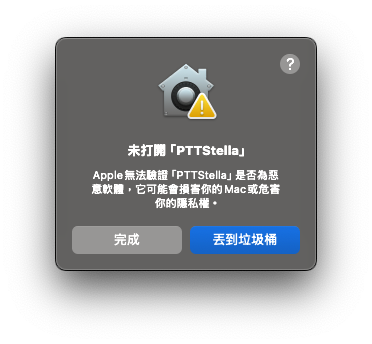
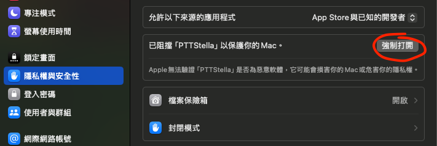
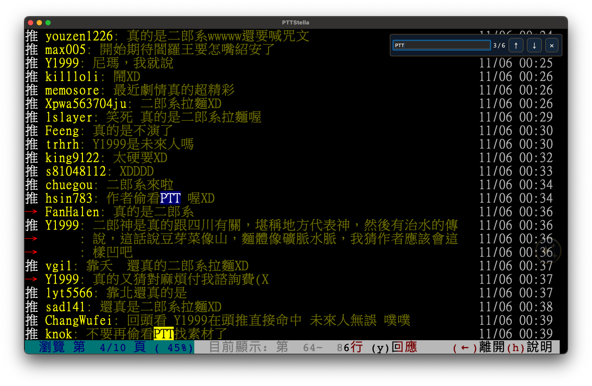
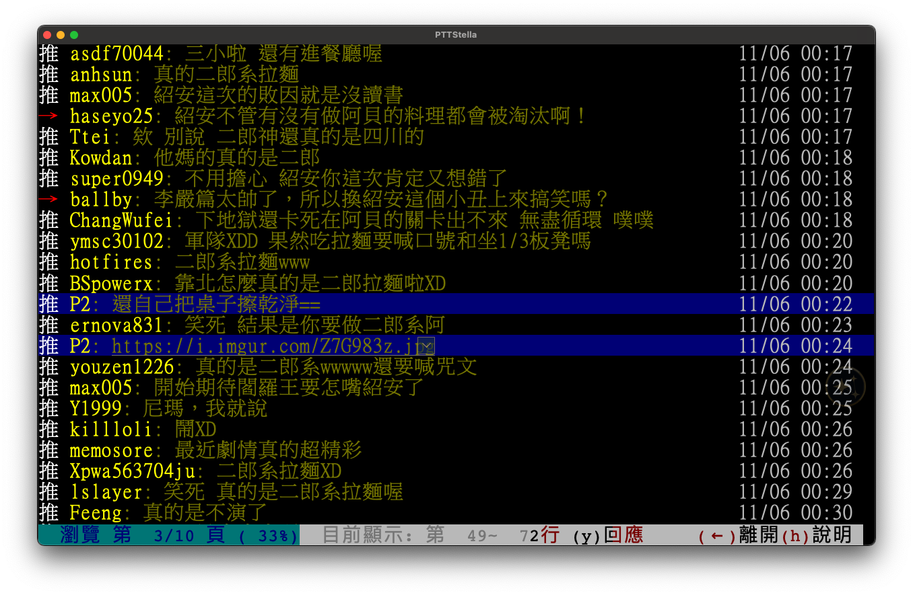
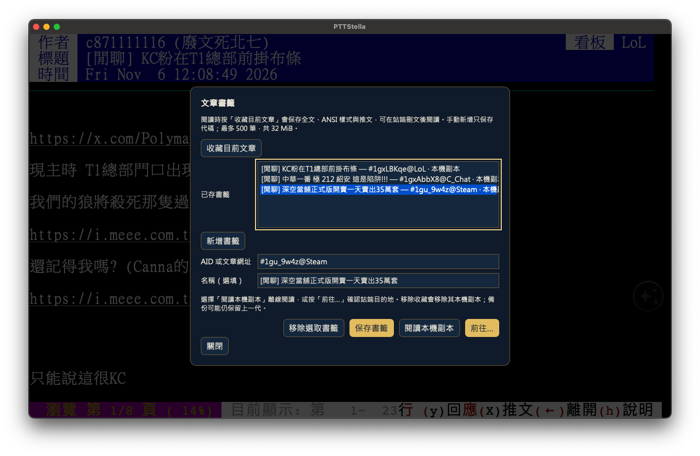
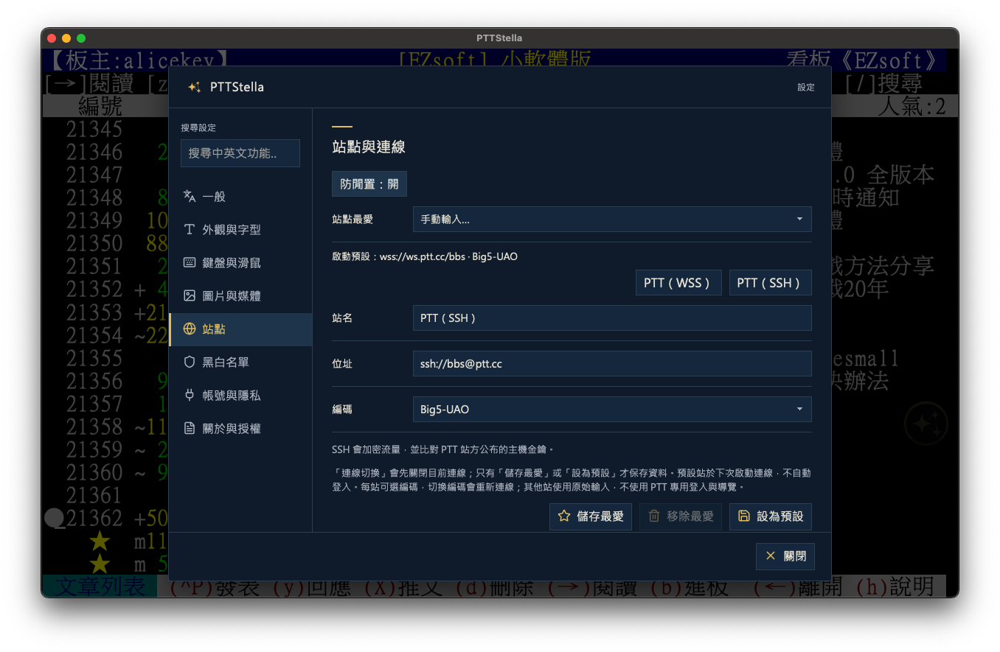
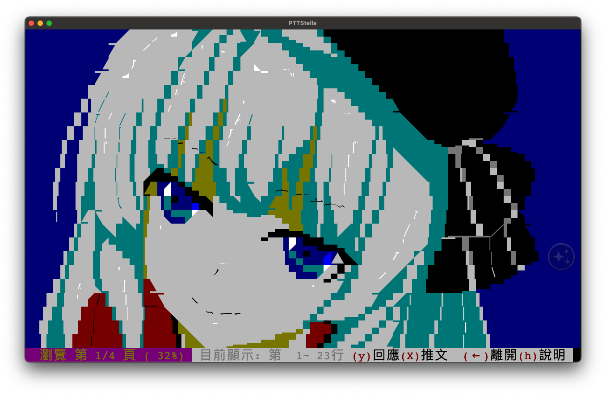
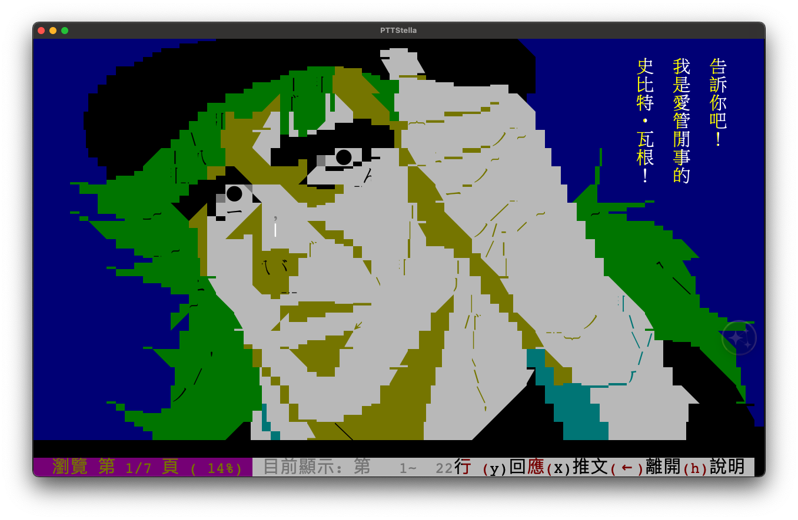
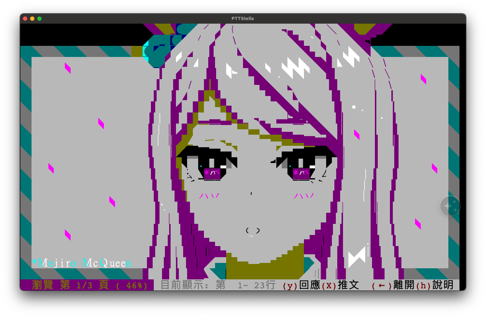

  

<h1 align="center">PTTStella</h1>

  <strong>保留 BBS 排版與 ANSI 色彩的 PTT 桌面瀏覽器。</strong>

  
  
  

  <a href="https://github.com/yam276/PTTStella/releases/latest"><strong>下載正式版</strong></a> ·
  <a href="#第一次開啟">開始使用</a> ·
  <a href="https://github.com/yam276/PTTStella/issues">回報問題</a>

## 下載與安裝

目前分支為開發版 `0.5.0-dev.3`，最新正式版為 `0.4.1`。請選擇對應的下載檔。[前往下載](https://github.com/yam276/PTTStella/releases/latest)

| 平台 | 安裝方式 |
| --- | --- |
| Windows 10／11 x64 | 執行 `-setup.exe` 安裝，或使用 `-portable.exe`。需要 WebView2，安裝版可協助補裝。[安裝說明](docs/windows-installer.md) |
| macOS | Apple Silicon 選 `arm64`，Intel 選 `x64`。打開 DMG 或解壓縮 ZIP 後，把 `PTTStella.app` 拖進「應用程式」。[安裝說明](docs/macos-release.txt) |
| Linux x64 | 提供 `.deb` 和 `.tar.gz`，以 Ubuntu 24.04 為目標。[安裝說明](docs/linux-package.txt) |

**macOS 首次開啟若出現開發者驗證提示**，先按「完成」關閉提示，再到「系統設定 → 隱私權與安全性 → 安全性」找到 PTTStella，按「強制打開」並依提示確認。[Apple 說明](https://support.apple.com/zh-tw/102445)

查看 macOS 首次開啟圖解

1. 在「未打開 PTTStella」提示中按「完成」。

   

2. 在「隱私權與安全性」找到 PTTStella，按紅圈標示的「強制打開」。

   

## 第一次開啟

1. 開啟 PTTStella，等畫面出現 PTT 帳號提示後，照平常方式登入。
2. 點畫面側邊的金色浮球，可開啟設定、收藏、擷取與登入工具。若要記住密碼，可在登入工具勾選保存到系統密碼庫。
3. 在選單或文章列表，可用方向鍵或滑鼠進入。閱讀時點左側返回，滾輪可捲動或翻頁。

## 常用功能

- **文章開圖**　預設的網頁模式可捲動全文，點圖片連結旁的箭頭或按 `Enter` 逐張開圖。偏好 PTT 原本的分頁，可在「設定 → 圖片與媒體」切換終端機模式。
- **快速前往與尋找**　按 `Cmd+K`／`Ctrl+K` 輸入板名、`#AID@板名` 或文章網址。文章內用 `Cmd+F`／`Ctrl+F` 找文字。
- **收藏與推文**　浮球「收藏」可保存文章的本機副本，斷線後也能讀。點推文的 ID 可標示同一人的回覆，也可用右鍵管理黑白名單。
- **草稿與擷取**　進入 PTT 編輯器後，可開啟「本機撰寫／草稿」編輯、上色與保存，再帶回 PTT 由你確認發表。浮球「擷取」可存檔或複製 PNG。
- **設定**　可調整字型、切換 PTT 的 WSS／SSH，或開啟 Vim 瀏覽（實驗中）。

## 功能擷圖

| 文章尋找 | 推文標示 |
| --- | --- |
|  |  |
| **文章收藏** | **WSS／SSH 連線** |
|  |  |

### ANSI 圖瀏覽

  
  
  

